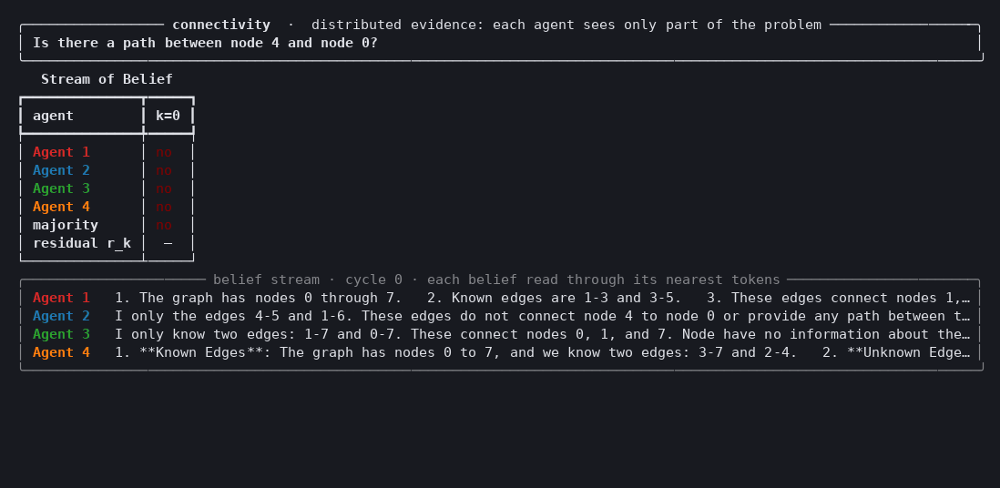

<div align="center">

<h1 align="center">Stream of Belief: 
Eliciting Collective Intelligence through Latent Belief Dynamics</h1>


[](https://arxiv.org/abs/2611.21250)
[](LICENSE)
[](pyproject.toml)




</div>

---

## Overview

**Stream of Belief (SoB)** lets a *team* of agents reason
through **continuous beliefs**: every agent holds a block of *belief tokens* (probability-weighted mixtures of
token embeddings), reads the other agents' beliefs directly at the embedding layer, and regenerates its own.
The joint belief state evolves as a dynamical system, $Z^{(k+1)}=\Phi_m(Z^{(k)})$, until further interaction no
longer changes the collective answer.

## Install

```bash
pip install -e .            # core: torch, transformers, rich
pip install -e ".[bench,viz]"   # + datasets / math-verify for benchmarks, matplotlib for GIFs
```

## Inference

```python
from sob import StreamOfBelief

sob = StreamOfBelief("Qwen/Qwen3-8B", N=4, L=384, m=1)     # the configuration of the paper
res = sob.solve("A bat and a ball cost $1.10. The bat costs $1.00 more than the ball. How much is the ball?")
print(res.answer, [c.probe_answers for c in res.cycles])
```

`res` carries the whole stream: per-cycle probe answers of every agent, the belief residual $r_k$, each belief
read "in its own latent words", and the agents' final solutions.

## Understanding Stream of Belief

| | |
|---|---|
| **Belief tokens** | $z_\ell=\sum_v p_\ell(v)\,E[v]$ over the top-50 tokens of the next-token distribution (Eq. 1). A belief is a block of $L$ such tokens, generated autoregressively and fed back at the embedding layer. |
| **Global interaction** $\mathsf G$ | each agent regenerates its belief after reading its own and the other agents' belief blocks. |
| **Local refinement** $\mathsf L$ | each agent regenerates its belief from its own belief only. |
| **Belief iteration** | one cycle is $\Phi_m=\mathsf L^m\circ\mathsf G$; the new block *replaces* the old one, so nothing accumulates. |
| **Collective equilibrium** | a fixed point $Z^\star=\Phi_m(Z^\star)$, tracked by the residual $r_k$; equilibrium does not require consensus. |
| **Stopping and readout** | after every cycle each agent decodes a short probe; stop when the majority probe is unchanged for $P$ cycles; decode full solutions from the final beliefs and vote. |

All prompts are in [`sob/agents.py`](sob/agents.py) (Appendix A of the paper); the dynamics are ~150 lines in
[`sob/dynamics.py`](sob/dynamics.py).

## Quick Start

```bash
sob run --task gsm8k --n 200 --model Qwen/Qwen3-8B --out gsm8k.jsonl     
sob run --task connectivity --size 8 --n 100 --distributed --L 96 --probe-style brief --probe-tokens 96
```

`--task` accepts `gsm8k`, `math500`, `mmlu_pro`, `gpqa_diamond`, `arc_challenge`, `medqa`,
`bbh_<subtask>`, `hotpotqa` (public HuggingFace versions) and the synthetic `connectivity`, `shortest_path`,
`fact_chain` and `relay` tasks (seeded, so `--seed`/`--index` name the same problem on every machine).


## Citation

```bibtex
@article{yao2026streamofbelief,
  title   = {Stream of Belief: Eliciting Collective Intelligence through Latent Belief Dynamics},
  author  = {Yao, Yu and Dong, Jiayi and Du, Yilun},
  journal = {arXiv preprint arXiv:2611.21250},
  year    = {2026}
}
```
